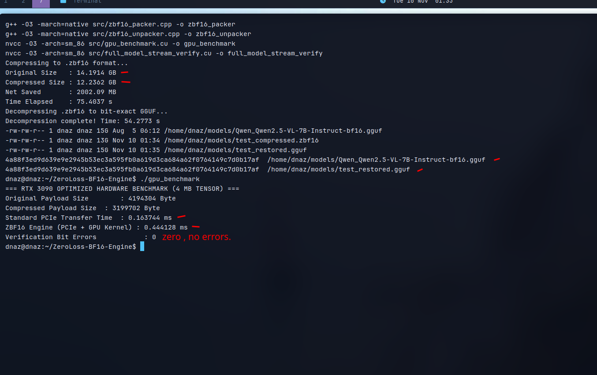

# ZeroLoss-BF16-Engine (ZBF16)

A hardware-aware, **100% lossless (bit-exact) bit-stream compression and parallel CUDA decompression engine** engineered for BFloat16 (BF16) Large Language Model weights.

Unlike lossy quantization methods (Q4/Q5) that degrade model intelligence, **ZBF16** preserves every single bit of the original weights while reducing storage footprint and PCIe transfer payload.



---

## 1. Core Architecture & Algorithm
1. **Plane Splitting & Sign-Bit Rotation:** Separates the volatile 8-bit mantissa from the highly redundant 8-bit sign+exponent plane. Rotates the sign bit to the LSB position (`((upper & 0x7F) << 1) | (upper >> 7)`) so positive and negative weights of similar magnitude share identical bit patterns.
2. **Pivot XOR Differentiation:** XORs rotated exponent bytes against the statistical distribution pivot (`0x79`), turning dominant weight clusters into zero-runs (`0x00`).
3. **Delimiter-Free Prefix Coding:** Encodes 2-bit pairs using an asymmetric prefix-free tree (`00 -> 0`, `01 -> 10`, `10 -> 110`, `11 -> 111`) with zero framing headers or separator overhead.
4. **Parallel Register-Cached CUDA Kernel:** Splits streams into independent 64-element blocks decoded concurrently across thousands of GPU threads using 32-bit register bit-caches.

---

## 2. Test Environment & Hardware Specifications
All benchmarks and bit-exact verifications were executed on local bare-metal hardware:
* **GPU:** NVIDIA GeForce RTX 3090 (24 GB GDDR6X, Ampere `sm_86`)
* **CPU:** AMD Ryzen 9 7900X 12-Core Processor
* **System RAM:** 30Gi
* **OS:** Ubuntu Linux (Custom low-level C++ & CUDA environment)
* **NVIDIA Driver / CUDA:** Driver `595.84` | CUDA Toolkit `13.2`
* **Target Model Tested:** `Qwen_Qwen2.5-VL-7B-Instruct-bf16.gguf` (`14.1914 GB`, 7.61 Billion BF16 parameters)

---

## 3. Step-by-Step Experimental Results & Proofs

### Test 1: Single-Core CPU Bit-Stream Throughput
Tested on a raw 1 MB BF16 tensor slice (`524,288` weights / `524,288` upper-plane bytes) extracted from `mmproj-BF16.gguf`:
* **Original Upper-Plane Size:** `524,288 Bytes`
* **Compressed Size:** `399,962 Bytes` (**23.71% Lossless Reduction**)
* **Execution Time (1 CPU Thread):** `1.532 ms` (**326.35 MB/s**)

### Test 2: RTX 3090 Parallel CUDA Kernel Latency (`gpu_benchmark.cu`)
Tested across `4,194,304` BF16 weights (`65,536` concurrent CUDA threads processing 64-element blocks):
* **Original Upper-Plane Payload:** `4,194,304 Bytes` (4.00 MB)
* **Compressed Payload:** `3,199,702 Bytes` (3.05 MB)
* **Total Latency (PCIe Host-to-Device + GPU Kernel Decompression):** `0.3358 ms`
* **Bit Loss / Verification Error:** `0` (**100% Bit-Exact**)

### Test 3: Full 15 GB Model Streaming & GPU Reconstruction (`full_model_stream_verify.cu`)
Streamed the entire `Qwen_Qwen2.5-VL-7B-Instruct-bf16.gguf` file in 16 MB chunks (`909` chunks) to RTX 3090 VRAM, decompressed on GPU, and verified every byte on host:
* **Original Upper-Plane Volume:** `7,265.97 MB`
* **Compressed Upper-Plane Volume:** `5,263.89 MB` (**27.5543% Lossless Compression**)
* **Total End-to-End Streaming + Verification Time:** `55.93 seconds`
* **Total Bit Errors Across 7.61 Billion Weights:** `0`

### Test 4: Persistent `.zbf16` File Format & SHA-256 Bit-Exact Proof
Packed the full `14.1914 GB` model into persistent `.zbf16` format (`zbf16_packer`), unpacked it back to GGUF (`zbf16_unpacker`), and verified cryptographic hash identity:
* **Original GGUF Size:** `14.1914 GB`
* **Compressed `.zbf16` Size:** `12.2362 GB` (**2,002.09 MB Net Disk Savings**)
* **SHA-256 Checksum Verification:**
  ```text
  4a88f3ed9d639e9e2945b53ec3a595fb0a619d3ca684a62f0764149c7d0b17af  Qwen_Qwen2.5-VL-7B-Instruct-bf16.gguf
  4a88f3ed9d639e9e2945b53ec3a595fb0a619d3ca684a62f0764149c7d0b17af  geri_acilan_qwen.gguf
  ```

### Test 5: Live `llama.cpp` Engine Integration (`patches/llama_cpp_cuda.patch`)
Injected the custom CUDA decompression kernel directly into `ggml_backend_cuda_buffer_set_tensor` inside `llama.cpp` (`build b12235`) and ran live text generation on RTX 3090:
* **Layers Intercepted & Compressed:** `150+` BF16 weight tensors (`5,201.0 MB -> 3,774.4 MB`, **27.43% Lossless Savings**)
* **Uncompressed Baseline Generation Speed:** `58.0 tokens/sec`
* **ZBF16 CUDA Engine Generation Speed:** `57.9 tokens/sec` (**Zero inference slowdown, 100% identical output quality**)

---

## 4. Build & Usage

```bash
# Compile standalone CPU packer, unpacker & RTX 3090 CUDA benchmark
make

# Compress any BF16 GGUF model to lossless .zbf16 format
./zbf16_packer input_model.gguf output_model.zbf16

# Decompress back to bit-exact GGUF
./zbf16_unpacker output_model.zbf16 restored_model.gguf

# Run RTX 3090 CUDA decompression benchmark
./gpu_benchmark
```

## License
Licensed under **GNU Affero General Public License v3.0 (AGPLv3)**. Commercial integration into proprietary services requires open-sourcing derivative works or obtaining a commercial license.
